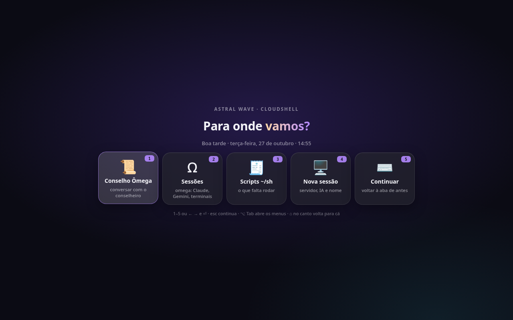
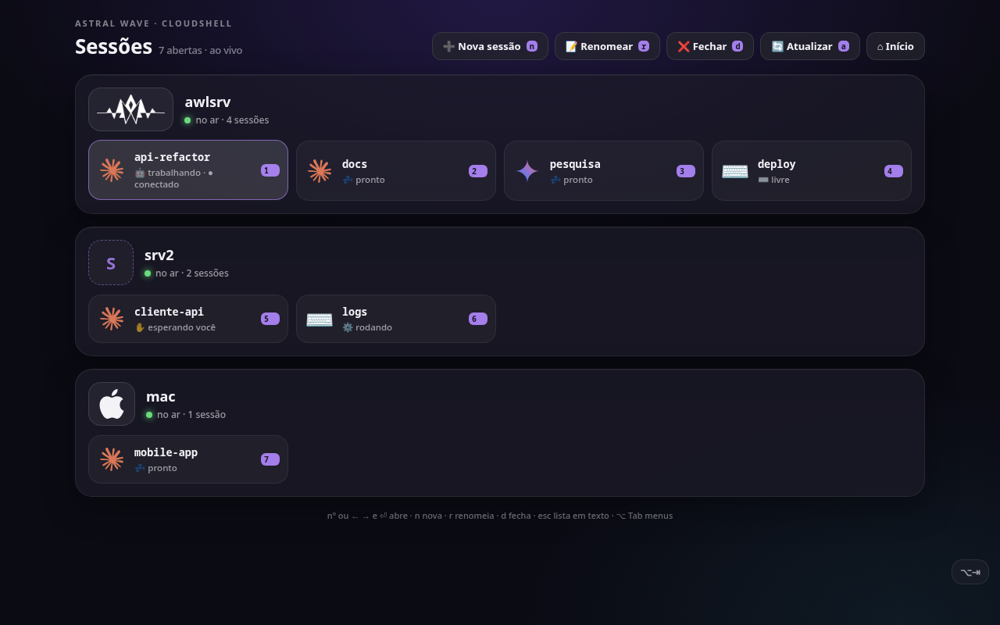
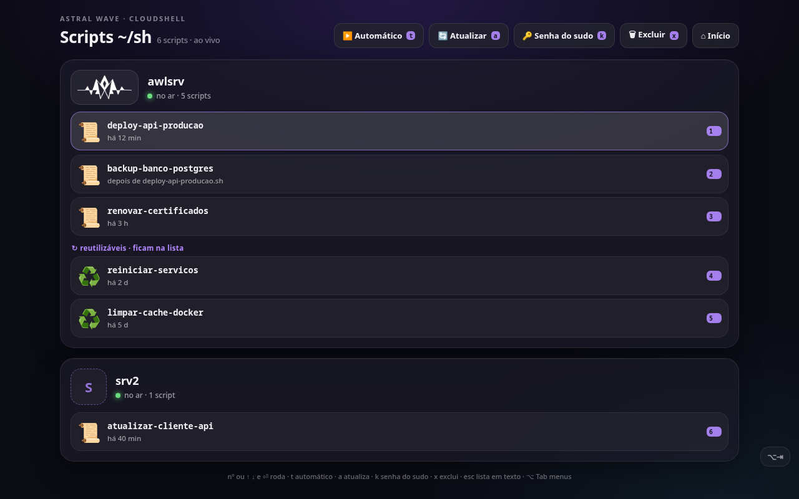
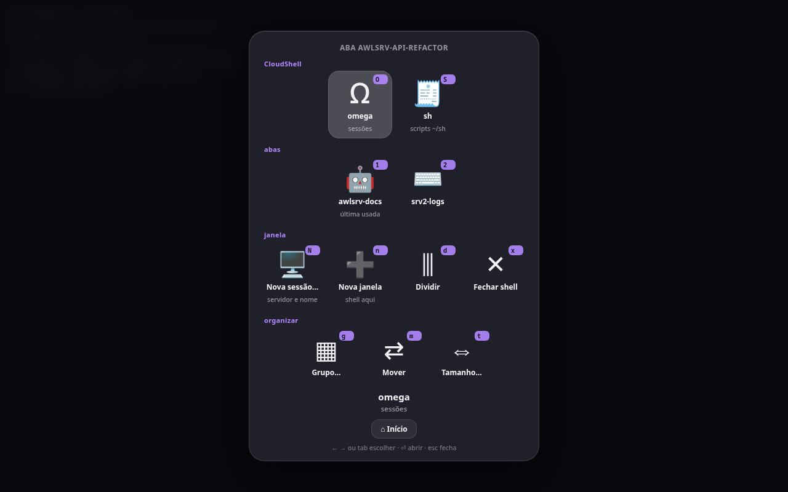
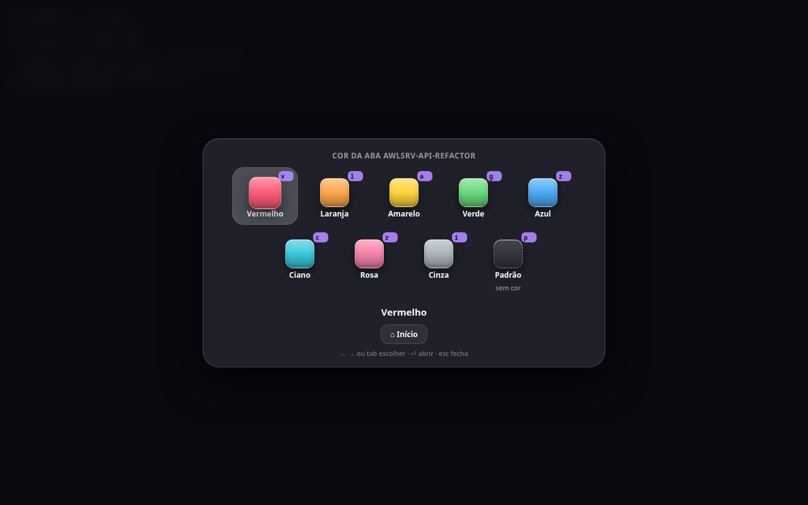
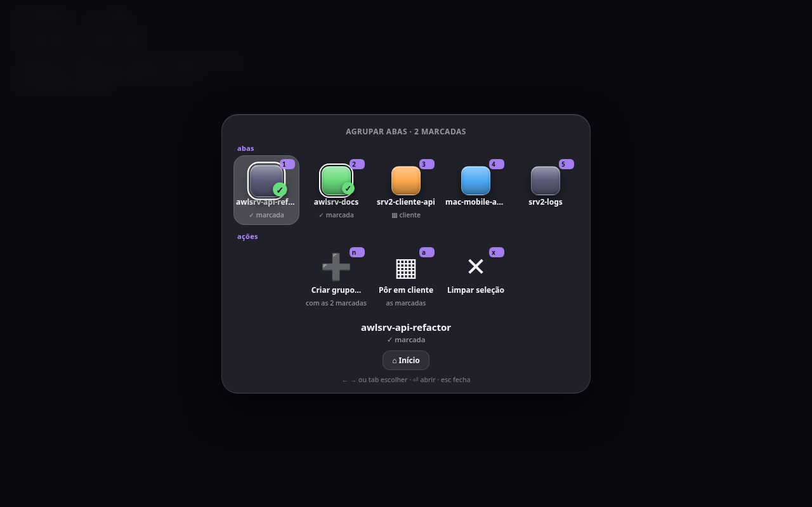

# OmegaShell

**Gerenciador multi-IA para múltiplos servidores, no navegador.**

O OmegaShell junta num app só (PWA, instalável no computador e no celular) as sessões de IA e os terminais de
vários servidores: Claude, Gemini e shells comuns rodando em tmux no servidor principal, num segundo servidor e
num Mac, todos abertos e controlados de uma tela só. Nasceu para o meu dia a dia, que tem vários agentes de IA
trabalhando ao mesmo tempo em projetos diferentes, cada um numa máquina.



## O que ele faz

- **Sessões de todos os servidores numa tela.** Um bloco por servidor, com logo, estado da conexão e um cartão
  por sessão. Ao vivo: mostra quem está **trabalhando**, quem está **pronto** e quem está **esperando você**.
  O Claude e o Gemini são reconhecidos pela tela da sessão (não só pelo processo).
- **Nova sessão em dois cliques.** Escolhe o servidor, a IA (Claude, Gemini ou só o terminal) e o nome; a
  sessão abre numa aba própria, com o servidor no nome (`srv2-cliente-api`).
- **Scripts de manutenção com histórico.** Os scripts pendentes de cada servidor em lista, com dependência
  entre eles ("depois de x.sh"), execução em ordem (modo automático), saída em aba própria (verde = ok,
  vermelho = falhou) e arquivamento automático do que terminou bem.
- **Tudo em botões, no estilo do Cmd+Tab do Mac.** Segurar **⌥ Option + Tab** abre o painel da aba atual;
  Tab anda, soltar o ⌥ abre. **⌥ C** abre a paleta de cores da aba e **⌥ G** agrupa abas escolhendo em
  caixinhas.
- **Fecha uma sessão de IA sem perder trabalho.** Ao encerrar, o Claude recebe `/quit` e o servidor roda o
  fechamento da sessão (auditoria de segurança, commit e push do que ficou, aviso no Telegram).

| Sessões por servidor | Scripts ~/sh |
|---|---|
|  |  |

| ⌥ Tab numa aba do Claude | ⌥ C — cor da aba | ⌥ G — agrupar abas |
|---|---|---|
|  |  |  |

## Como funciona

```
navegador (PWA)                         container cloudshell                     servidor(es)
┌───────────────────────┐   HTTPS   ┌──────────────────────────────┐   SSH    ┌─────────────────────────────┐
│ xterm.js (ttyd)       │──────────▶│ nginx ─ login (Vue + 2FA)     │─────────▶│ tmux por conta (abas)       │
│ botoes.js  inicio.js  │◀── OSC ───│ gateway Node/TS (sessão)      │  chave   │ omega: sessões, IA, scripts │
│ sessoes.js            │   7717    │ ttyd ─ ssh com comando fixo   │  restrita│ host/: abas.sh, botoes.sh   │
└───────────────────────┘           └──────────────────────────────┘          └──────────────┬──────────────┘
                                                                                             │ ssh
                                                                               srv2, mac (tmux + Claude/Gemini)
```

- **omega** (`omega/omega`, bash) é o gerenciador: lista as sessões tmux de todos os servidores (local, srv2
  pelo ssh, Mac pelo ssh), detecta Claude/Gemini e o estado de cada um, abre/renomeia/fecha sessões e roda os
  scripts `~/sh` com histórico. Funciona sozinho num terminal; dentro do CloudShell abre cada coisa numa aba.
- **CloudShell** (`cloudshell/`) é o terminal web: login com e-mail, senha e 2FA (TOTP) no LoginHUB, depois
  um terminal (ttyd + xterm.js) que entra por SSH com uma chave restrita a um comando — ela só abre a sessão
  tmux da conta, sem túnel nem shell solto.
- **Os botões são desenhados pelo navegador, mas quem manda é o terminal.** O omega e os menus do tmux
  escrevem uma sequência OSC 7717 (o menu em JSON, base64) no terminal; a página (`pwa/botoes.js`,
  `pwa/sessoes.js`) desenha os botões por cima. O clique só **digita** a tecla do item — o programa continua
  lendo do teclado como sempre, e o menu em texto continua valendo. Nenhum comando sai da página.
- A página recarrega sozinha quando sai versão nova dos scripts dela (ETag), sem derrubar as sessões tmux.

## Stack

Bash · tmux · ttyd / xterm.js · nginx · Node.js + TypeScript (gateway de sessão) · Vue 3 + Vite (login com 2FA)
· Docker · Cloudflare Tunnel · Claude Code e Gemini CLI como agentes.

## Estrutura

```
cloudshell/
  Dockerfile, nginx.conf, entrypoint.sh, cloudshell-login, ssh_config, known_hosts (vazio: o seu servidor)
  gateway/   sessão e login (Node/TS) contra o LoginHUB
  web/       telas de login, 2FA e convite (Vue)
  pwa/       botoes.js (painel ⌥ Tab), inicio.js (página inicial), sessoes.js (Sessões/Scripts), ícones, logos
  host/      lado do servidor: tmux.conf, abas.sh (menus), botoes.sh (OSC 7717), sessao.sh, fixas.sh
omega/omega  o gerenciador de sessões, IA e scripts
```

## Observações

- É o código que roda no meu servidor, publicado como está: nomes de servidor, contas e domínios foram
  trocados por exemplos (`srv2`, `macuser`, `*.example.com`) e as chaves do servidor não vêm junto. Para usar
  em outro lugar é preciso ajustar esses pontos (os remotos ficam no começo do `omega/omega`).
- O login usa o [LoginHUB](https://github.com/moablive/LoginHUB), o login central da minha suíte
  [LifeBusinessSuit](https://github.com/moablive/LifeBusinessSuit).
- Comentários e textos em português.

---

Feito por [Guilherme Bonato](https://moablive.github.io/).
